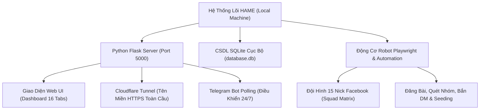
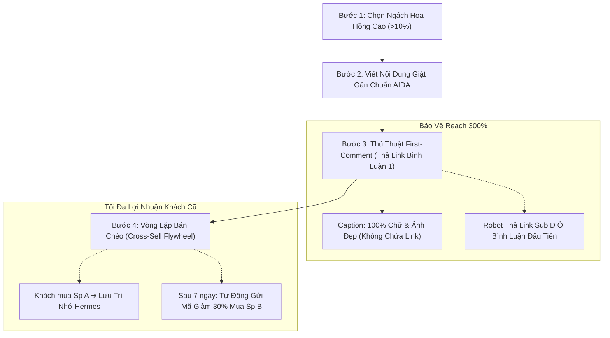

# 📕 SÁCH HƯỚNG DẪN SỬ DỤNG TOÀN DIỆN HAME ENTERPRISE
## HỆ THỐNG TỰ ĐỘNG HÓA FACEBOOK MARKETING, NUÔI NICK, BÁN HÀNG & AFFILIATE DOANH NGHIỆP
*Phiên bản: Enterprise Master Suite (ReactBits Motion & Squad Matrix Edition)*

---

## 📑 MỤC LỤC

1. [TỔNG QUAN KIẾN TRÚC & TRIẾT LÝ VẬN HÀNH ĐỘC LẬP](#chương-1-tổng-quan-kiến-trúc--triết-lý-vận-hành-độc-lập)
2. [HƯỚNG DẪN CÀI ĐẶT TRÊN MÁY TÍNH MỚI (CHỈ 1 BƯỚC)](#chương-2-hướng-dẫn-cài-đặt-trên-máy-tính-mới-chỉ-1-bước)
3. [THIẾT LẬP CẤU HÌNH BAN ĐẦU (AI, TELEGRAM, AFFILIATE)](#chương-3-thiết-lập-cấu-hình-ban-đầu-ai-telegram-affiliate)
4. [HƯỚNG DẪN CHI TIẾT 16 PHÂN HỆ GIAO DIỆN WEB UI](#chương-4-hướng-dẫn-chi-tiết-16-phân-hệ-giao-diện-web-ui)
5. [CHIẾN THUẬT MA TRẬN TÁC CHIẾN 15 NICK (SQUAD MATRIX)](#chương-5-chiến-thuật-ma-trận-tác-chiến-15-nick-squad-matrix)
6. [ĐIỀU HÀNH TỪ XA QUA TELEGRAM BOT (TRỌN BỘ 13 LỆNH)](#chương-6-điều-hành-từ-xa-qua-telegram-bot-trọn-bộ-13-lệnh)
7. [TRIỂN KHAI TÊN MIỀN CÔNG CỘNG MIỄN PHÍ TOÀN CẦU (HTTPS)](#chương-7-triển-khai-tên-miền-công-cộng-miễn-phí-toàn-cầu-https)
8. [KỊCH BẢN KIẾM TIỀN AFFILIATE CHỐNG BÓP REACH & CROSS-SELL](#chương-8-kịch-bản-kiếm-tiền-affiliate-chống-bóp-reach--cross-sell)
9. [QUY TRÌNH VẬN HÀNH CHUẨN DOANH NGHIỆP HÀNG NGÀY (SOP)](#chương-9-quy-trình-vận-hành-chuẩn-doanh-nghiệp-hàng-ngày-sop)
10. [BÍ QUYẾT BẢO VỆ NICK, PHÒNG TRÁNH VÀ XỬ LÝ CHECKPOINT](#chương-10-bí-quyết-bảo-vệ-nick-phòng-tránh-và-xử-lý-checkpoint)
11. [XỬ LÝ SỰ CỐ KỸ THUẬT (TROUBLESHOOTING A - Z)](#chương-11-xử-lý-sự-cố-kỹ-thuật-troubleshooting-a---z)

---

## CHƯƠNG 1: TỔNG QUAN KIẾN TRÚC & TRIẾT LÝ VẬN HÀNH ĐỘC LẬP

HAME Enterprise (FBPoster Suite) là giải pháp công nghệ toàn diện phục vụ hoạt động bán hàng, tiếp thị liên kết (Affiliate Marketing) và quản lý dàn tài khoản Facebook ở quy mô công nghiệp.



### Triết lý "100% Cục Bộ - Không Phụ Thuộc Máy Chủ Trung Gian"
- **Dữ liệu riêng tư tuyệt đối:** CSDL SQLite (`database.db`), danh sách Cookie tài khoản, bài viết, khách hàng tiềm năng được lưu ngay trên ổ cứng máy tính cá nhân.
- **Không tốn phí duy trì server:** Không yêu cầu thuê VPS hay Cloud hosting tốn kém để chạy core logic.
- **Tách biệt hoàn toàn giữa các máy tính:** Khi bạn chuyển giao gói phần mềm cho đối tác, cộng tác viên hoặc nhân viên, máy của họ trở thành một trạm độc lập tự sinh tự diệt, không liên quan hay ảnh hưởng đến máy của bạn.

---

## CHƯƠNG 2: HƯỚNG DẪN CÀI ĐẶT TRÊN MÁY TÍNH MỚI (CHỈ 1 BƯỚC)

Gói cài đặt độc lập được đóng gói sẵn trong tệp `HAME_Enterprise_Bo_Cai_Dat_Full.zip`.

### 📌 Các bước cài đặt:
1. **Giải nén:** Nhấp chuột phải vào file `.zip` ➔ Chọn **Extract All...** ➔ Chọn thư mục đích (Ví dụ: `D:\HAME_Enterprise` hoặc `C:\HAME_Enterprise`).
2. **Kích hoạt tự động:** Nhấp đúp chuột vào tệp:
   > **`1_CLICK_CAI_DAT_VA_CHAY.bat`**
3. **Cơ chế tự động hóa phía sau:**
   - Script tự động kiểm tra xem máy tính đã có Python hay chưa. Nếu chưa có, script tự động tải bản cài đặt Python 3.10 chính thức từ python.org và cài đặt ngầm trong 1 - 2 phút.
   - Tự động nạp toàn bộ thư viện thông qua lệnh `pip install -r requirements.txt`.
   - Tự động thiết lập cấu trúc CSDL SQLite sạch ban đầu.
   - Tự động tạo biểu tượng lối tắt **`FBPoster Enterprise`** ngoài màn hình Desktop.
   - Tự động khởi động máy chủ và mở trình duyệt tại địa chỉ `http://localhost:5000`.

### 🚀 Khởi động hàng ngày:
Sau khi đã cài đặt lần đầu, những ngày sau người dùng chỉ cần:
- Nhấp đúp biểu tượng **`FBPoster Enterprise`** ngoài Desktop.
- Hoặc chạy file **`KHOI_DONG_PHAN_MEM.bat`** trong thư mục phần mềm.

---

## CHƯƠNG 3: THIẾT LẬP CẤU HÌNH BAN ĐẦU (AI, TELEGRAM, AFFILIATE)

Sau khi mở Web UI tại `http://localhost:5000`, truy cập vào tab **Cấu hình** (`#tab-settings`) ở danh mục bên trái:

| Tham số cấu hình | Ý nghĩa & Hướng dẫn thiết lập | Khuyến nghị |
| :--- | :--- | :--- |
| **Gemini API Key** | Mã khóa AI Google Gemini dùng để viết content marketing, phân tích cảm xúc khách và sinh kịch bản chat. | Lấy miễn phí tại Google AI Studio. |
| **Telegram Bot Token** | Mã Token điều khiển từ xa. Tạo qua Bot `@BotFather` trên Telegram (`/newbot`). | Giúp quản trị bằng điện thoại 24/7. |
| **Telegram Chat ID** | ID người nhận báo cáo. Hệ thống tự động nhận diện khi bạn nhắn tin đầu tiên tới Bot. | Để trống nếu chưa rõ ID. |
| **Shopee Affiliate ID** | ID mạng lưới tiếp thị Shopee của bạn. | Nhập đúng ID để tính hoa hồng. |
| **Shopee SubID** | Nhãn phân luồng chiến dịch (Ví dụ: `hame_campaign`, `fb_auto`). | Giúp theo dõi doanh số từng kênh. |
| **Khoảng cách đăng bài** | Độ trễ giữa 2 lần đăng liên tiếp (giây). | Đặt từ **600 đến 1200 giây** (10-20 phút). |
| **Chế độ chống Checkpoint** | Bật tự động đổi User-Agent và ngắt nghỉ hành vi chuột người thật. | **BẬT** liên tục. |

---

## CHƯƠNG 4: HƯỚNG DẪN CHI TIẾT 16 PHÂN HỆ GIAO DIỆN WEB UI

Giao diện trực quan chia thành 16 phân hệ quản trị:

```
┌────────────────────────────────────────────────────────────────────────┐
│ 🏛️ FBPoster Enterprise v29.0 (ReactBits Motion & Visual Edition)       │
├───────────────────┬────────────────────────────────────────────────────┤
│ 📊 Bảng điều khiển│  [📊 Tổng Lượt Đăng]  [💰 Tổng Hoa Hồng Dự Kiến]   │
│ 👤 Quản lý nick   │  [⚡ Trạng Thái Worker] [🎯 15-Account Squad Matrix]│
│ ✍️ Soạn bài AI     │                                                    │
│ 🚀 Đăng hàng loạt │  [🏛️ Hermes Studio Hub] [🧠 GBrain Graph]          │
│ 🌱 Nuôi Nick Auto │                                                    │
│ 💬 Auto DM & Leads│  [🎯 AI Cross-Sell Studio] [👁️ Mano-P Live View]   │
│ ⚙️ Cấu hình       │                                                    │
└───────────────────┴────────────────────────────────────────────────────┘
```

### 1. 📊 Bảng điều khiển (Dashboard)
- Hiển thị nhịp tim hệ thống: Tổng bài viết thành công, tỷ lệ duyệt nhóm, biểu đồ phân tích lượt click Affiliate theo thời gian thực.
- Báo cáo nhanh tài khoản hoạt động và các tiến trình Worker ngầm.

### 2. 👤 Quản lý tài khoản (Accounts)
- **Thêm tài khoản bằng Cookie:** Copy chuỗi Cookie từ trình duyệt Facebook vào ô nhập liệu ➔ Bấm **Thêm tài khoản**.
- **Điểm uy tín (Trust Score):** Thang điểm 0 - 100 đo lường độ an toàn của nick. Điểm càng cao (>85), thuật toán Facebook càng ít quét kiểm tra.
- **Phân loại vai trò:** Nhãn hiển thị nick thuộc Đội Profile VIP, Đội Rải Bài hay Đội Seeding.
- **Auto-Login:** Nhấp một chạm để kiểm tra trạng thái sống/chết (Live/Die) của tài khoản mà không cần mở trình duyệt thủ công.

### 3. ✍️ Soạn bài viết (Create Post)
- **Trợ lý Gemini Copywriting:** Nhập từ khóa sản phẩm ➔ Bấm **"AI Viết Content"** ➔ Tự động sinh nội dung chuẩn mô hình AIDA (Chú ý - Thích thú - Khao khát - Hành động) kèm icon thu hút.
- **Chế độ Bình Luận Đầu Tiên (First Comment):** Bật tùy chọn này để đưa link sản phẩm xuống dòng bình luận số 1, giúp caption giữ độ tự nhiên 100%.
- **Đặt lịch hẹn giờ:** Đặt chính xác ngày giờ phát hành bài viết trong tương lai.

### 4. 🚀 Đăng hàng loạt (Bulk Posting)
- Quản lý danh mục 200+ nhóm Facebook mục tiêu chia theo chủ đề: Bỉm sữa, Sinh viên, Dân văn phòng, Đồ công nghệ.
- Tự động xoay vòng tài khoản (Account Rotation) giúp tránh hiện tượng một nick đăng quá nhiều bài cùng lúc.

### 5. 🕒 Lịch sử & Hẹn giờ (Scheduled Posts)
- Quản lý trạng thái bài viết: `Đang chờ`, `Đang đăng`, `Thành công`, `Lỗi`.
- Có thể hủy bài, sửa lại nội dung hoặc bấm **"Đăng Ngay"** để cưỡng chế kích hoạt.

### 6. 💬 Tương tác tự động (Engagement & Auto-Bump)
- Tự động đi bình luận trả lời khách hàng dưới bài viết đã đăng khi phát hiện từ khóa: *"giá", "inbox", "mua", "tư vấn"*.
- **Auto-Bump:** Tự đẩy bài viết cũ lên đầu bảng tin nhóm sau mỗi 4 tiếng bằng một comment ngắn mang tính thảo luận.

### 7. 👍 Auto-Like
- Tự động like các bài viết mới nhất trên Fanpage hoặc Group chỉ định để tăng nhận diện thương hiệu cho các tài khoản vệ tinh.

### 8. 👥 Tự động tham gia nhóm (Auto Group Joiner)
- Tìm kiếm nhóm công khai/nhóm kín theo từ khóa ngách.
- Robot tự động bấm nút tham gia kèm trả lời câu hỏi xét duyệt nhóm (nếu có).

### 9. 🎯 Auto DM & Quét Nhóm (Lead Scraper & Auto-Closer)
- Nhập URL nhóm khách hàng mục tiêu ➔ Robot tự động quét thành viên tương tác cao nhất.
- Gửi tin nhắn chào hàng cá nhân hóa trực tiếp vào hộp thư Messenger với biến `{name}` thân thiện.

### 10. 🌱 Nuôi Nick Tự Động (Account Nurturing)
- Mô phỏng hành vi người thật: Tự lướt Newfeed từ 3 - 5 phút, dừng lại xem video Reels >15 giây, thả tim ngẫu nhiên và đọc comment.
- Cột nhật ký màu xanh lá bên dưới hiển thị từng hành động thao tác ngầm của Robot.

### 11. 🏛️ Hermes Studio Hub
- **Active Sessions:** Quản lý các phiên hội thoại AI đang trực tiếp tư vấn khách.
- **Scheduled Jobs Visualizer:** Bảng đồng hồ 4 tác vụ ngầm (Lịch 7 ngày, Nuôi nick, Săn deal, Bán chéo).
- **Google Sheets Sync:** Xuất báo cáo tài chính hoa hồng ra bảng tính Google chỉ bằng 1 nút bấm.
- **Mano-P Live Screenshot:** Xem ảnh chụp màn hình máy tính trực tiếp từ Robot để phát hiện kịp thời các cảnh báo từ Facebook.

### 12. 🔍 Quét Leads & Phân Tích Ý Định Mua (Insights Radar)
- Theo dõi các bài đăng của đối thủ trong ngành, AI tự phát hiện khách hàng để lại bình luận có nhu cầu mua cao và đưa vào phễu tiếp cận.

### 13. 📅 Lịch Claude (Claude Schedule Import)
- Hỗ trợ nhập lịch trình nội dung dạng Markdown hoặc bảng biểu đã sinh từ Claude/ChatGPT để lập lịch tự động cho cả tháng.

### 14. 🏷️ Quản Lý Mẫu Bài & Deal Shopee (Templates & Flash Sale)
- Lưu trữ các mẫu bài viết chuyển đổi cao.
- Công cụ cào sản phẩm giảm giá sốc trên Shopee theo từ khóa (Ví dụ: *"Nồi chiên không dầu"*, *"Son môi"*).

### 15. 🔗 Phân Tích Link FB (Link Analyzer)
- Kiểm tra link nhóm, bài viết xem có công khai không, số lượng thành viên và đánh giá độ tương tác tiềm năng.

### 16. 🌍 World Monitor Radar
- Radar thu thập xu hướng mua sắm quốc tế, dự đoán các mặt hàng chuẩn bị tạo trend tại Việt Nam.

---

## CHƯƠNG 5: CHIẾN THUẬT MA TRẬN TÁC CHIẾN 15 NICK (SQUAD MATRIX)

Để đạt hiệu quả chuyển đổi tối đa và an toàn dài hạn, HAME Enterprise vận hành theo kiến trúc **Ma Trận Tác Chiến 15 Tài Khoản** chia thành 3 phân đội:

```mermaid
flowchart LR
    subgraph Squad1["🥇 ĐỘI 1: PROFILE VIP (3 Nick)"]
        A1["Xây Dựng Thương Hiệu Cá Nhân"]
        A2["Tự Động Chốt Đơn Messenger"]
        A3["Bán Chéo Khách Cũ (Cross-Sell)"]
    end

    subgraph Squad2["🥈 ĐỘI 2: FLASH SALE POSTER (7 Nick)"]
        B1["Cào Deal Shopee Hot >50%"]
        B2["Rải Bài 200+ Nhóm Ngách"]
        B3["Kèm Link Tiếp Thị SubID"]
    end

    subgraph Squad3["🥉 ĐỘI 3: SEEDING ĐÁM ĐÔNG (5 Nick)"]
        C1["Bình Luận Mồi Dưới Bài Đội 2"]
        C2["Hỏi Mua / Review Đã Nhận Hàng"]
        C3["Kích Hoạt Hiệu Ứng Bán Chạy"]
    end

    Squad2 -->|Đăng bài xong| Squad3
    Squad3 -->|Tạo tương tác hút khách| Squad1
```



### Nguyên tắc phối hợp tác chiến:
1. **Đội 2 đăng bài:** Các tài khoản Poster đăng hình ảnh sản phẩm và nội dung giật gân vào các hội nhóm ngách.
2. **Đội 3 mồi tương tác:** Ngay sau khi bài viết lên được 3 - 5 phút, 5 nick Seeding tự động vào bình luận: *"Em vừa nhận hàng hôm qua, chất xịn lắm shop ơi"*, *"Check inbox mình với"*. Người dùng thật thấy bài sôi nổi sẽ tin tưởng bấm vào link mua hàng.
3. **Đội 1 chốt đơn:** Những khách hàng quan tâm sẽ nhắn tin vào Fanpage hoặc Profile VIP. Đội 1 dùng AI tư vấn chốt đơn, đồng thời lưu sở thích vào Trí nhớ Hermes để sau 7 ngày tự động gửi tin nhắn bán chéo sản phẩm thứ hai.

---

## CHƯƠNG 6: ĐIỀU HÀNH TỪ XA QUA TELEGRAM BOT (TRỌN BỘ 13 LỆNH)

Không cần ngồi trước máy tính, bạn có thể điều khiển toàn bộ cỗ máy ở bất kỳ đâu thông qua ứng dụng Telegram trên điện thoại:

| Lệnh Telegram | Cú pháp mẫu | Mô tả tác vụ |
| :--- | :--- | :--- |
| **`/flashsale`** | `/flashsale Mỹ Phẩm` | Cào các deal Shopee giảm giá >50% và tự động rải vào các nhóm phù hợp. |
| **`/affstats`** | `/affstats` | Xem báo cáo tổng số link tiếp thị, số click và số tiền hoa hồng kiếm được trong ngày. |
| **`/crosssell`** | `/crosssell Balo Laptop` | AI lọc danh sách khách cũ và nhắn tin tặng mã ưu đãi 30% để chốt đơn lần hai. |
| **`/gwsheet`** | `/gwsheet` | Đồng bộ toàn bộ dữ liệu đơn hàng và lịch đăng bài ra Google Sheets & Google Calendar. |
| **`/gmail`** | `/gmail` | Gửi một bản tin tóm tắt doanh số chi tiết về hòm thư Gmail của bạn. |
| **`/radar`** | `/radar` | Xem báo cáo thị trường: Mặt hàng nào đang có lượt tìm kiếm tăng đột biến. |
| **`/snap`** | `/snap` | Yêu cầu máy chủ chụp ảnh màn hình hoạt động ngay lập tức và gửi ảnh về Telegram. |
| **`/reengage`** | `/reengage` | AI quét lại các khách hàng từng nhắn tin nhưng chưa mua để gửi lời mời bám đuổi. |
| **`/joingroups`** | `/joingroups Hội Mua Bán Đồ Gia Dụng` | Tự động tìm kiếm và gửi yêu cầu gia nhập các nhóm Facebook đúng từ khóa. |
| **`/createvideo`** | `/createvideo Giày Sneaker 350000 all` | Tự động viết kịch bản, ghép video ngắn và đăng lên Facebook Reels/Group. |
| **`/targetfriends`** | `/targetfriends https://facebook.com/nick_doi_thu` | Quét tệp bạn bè công khai của đối thủ và gửi lời mời kết bạn tự động. |
| **`/inbox`** | `/inbox` | Bật chế độ trực chat tự động: AI trả lời khách trên Messenger 24/7. |
| **`/squad`** | `/squad` | Kiểm tra trạng thái và phân bổ nhiệm vụ cho Ma trận 15 Nick Facebook. |

---

## CHƯƠNG 7: TRIỂN KHAI TÊN MIỀN CÔNG CỘNG MIỄN PHÍ TOÀN CẦU (HTTPS)

Khi bạn muốn truy cập giao diện phần mềm từ điện thoại qua mạng 4G hoặc gửi các đường link Landing Page cho khách hàng mà không cần ở cùng mạng Wi-Fi:

### 1. Kích hoạt bằng 1-Click:
Nhấp đúp chuột vào tệp:
> **`MO_TEN_MIEN_ONLINE_CLOUDFLARE.bat`**

### 2. Đường link công cộng của bạn:
Hệ thống Cloudflare Tunnel sẽ cấp một đường link HTTPS bảo mật toàn cầu có cấu trúc:
`https://[chuỗi_ngẫu_nhiên].trycloudflare.com`

### 3. Các đường link Landing Page Affiliate tự động tạo sẵn:
- **Ngành Skincare & Mỹ Phẩm:** `[Domain]/landing/hong-nhung-skincare-vip`
- **Ngành Balo & Túi Xách:** `[Domain]/landing/mai-anh-balo-oxford`
- **Ngành Gia Dụng Thông Minh:** `[Domain]/landing/khanh-linh-gia-dung-smart`
- **Ngành Giày & Streetwear:** `[Domain]/landing/minh-thu-sneaker-auth`

---

## CHƯƠNG 8: KỊCH BẢN KIẾM TIỀN AFFILIATE CHỐNG BÓP REACH & CROSS-SELL

Thuật toán Facebook có cơ chế siết chặt tương tác đối với các bài viết chứa liên kết rời ra ngoài mạng xã hội. Để giải quyết triệt để, HAME ứng dụng kịch bản 4 bước:



---

## CHƯƠNG 9: QUY TRÌNH VẬN HÀNH CHUẨN DOANH NGHIỆP HÀNG NGÀY (SOP)

Dành cho chủ doanh nghiệp hoặc nhân viên vận hành, mỗi ngày chỉ cần **5 phút** điều khiển qua Telegram theo thời gian biểu chuẩn sau:

| Khung giờ | Thao tác trên Telegram (Dưới 1 phút) | Hệ thống tự động thực thi ngầm |
| :--- | :--- | :--- |
| **08:00 Sáng** | Gõ `/radar` và `/flashsale Mỹ Phẩm` | Robot quét deal hot giảm >50% trên Shopee và rải bài kèm link vào 50 nhóm sáng. |
| **12:00 Trưa** | Gõ `/inbox` và `/snap` | AI quét hộp thư Messenger trả lời khách; gửi ảnh chụp màn hình kiểm tra máy về điện thoại. |
| **16:00 Chiều** | Gõ `/targetfriends <URL_Đối_Thủ>` và `/nurture` | Bóc bạn bè của đối thủ để gửi lời mời kết bạn; tự động nuôi nick lướt Newfeed và xem Reels. |
| **20:00 Tối** | Gõ `/crosssell <Tên_Sản_Phẩm>` và `/affstats` | Nhắn tin bán chéo tặng mã ưu đãi cho khách cũ; xuất báo cáo tổng kết hoa hồng trong ngày. |

---

## CHƯƠNG 10: BÍ QUYẾT BẢO VỆ NICK, PHÒNG TRÁNH VÀ XỬ LÝ CHECKPOINT

### 🛡️ Nguyên tắc "3 KHÔNG" bất di bất dịch:
1. **Không đăng bài quá nhanh:** Luôn giữ độ trễ giữa 2 lần đăng từ 10 - 20 phút. Đăng quá 10 bài/phút chắc chắn sẽ bị gắn cờ Spam.
2. **Không dùng nội dung trùng lặp:** Hãy sử dụng Gemini AI để mỗi nhóm là một bài viết với câu từ khác nhau hoàn toàn.
3. **Không bỏ qua khâu nuôi nick:** Nick mới nhập Cookie phải được nuôi tương tác ít nhất 3 ngày trước khi đi rải bài hàng loạt.

### 🆘 Cách khắc phục khi tài khoản dính Checkpoint:
1. Hệ thống **Mano-P Checkpoint Guard** sẽ phát hiện khi nick bị khóa và gửi ảnh cảnh báo về Telegram.
2. Bạn mở trình duyệt trên máy tính cá nhân, đăng nhập lại tài khoản đó và vượt qua bước xác minh (OTP/chọn ảnh bạn bè).
3. Sau khi vào lại bình thường, copy chuỗi Cookie mới ➔ Vào tab **Quản Lý Tài Khoản** trên Web UI ➔ Bấm **Cập nhật Cookie** ➔ Trạng thái tài khoản sẽ trở lại `active` ngay lập tức.

---

## CHƯƠNG 11: XỬ LÝ SỰ CỐ KỸ THUẬT (TROUBLESHOOTING A - Z)

### ❓ 1. Truy cập `http://localhost:5000` bị báo "Không thể kết nối" (Connection Refused):
- **Nguyên nhân:** Máy chủ Flask chưa được bật hoặc đã bị đóng cửa sổ chạy ngầm.
- **Cách xử lý:** Nhấp đúp chuột vào file `KHOI_DONG_PHAN_MEM.bat` trong thư mục phần mềm để kích hoạt lại.

### ❓ 2. Báo lỗi `No module named ...`:
- **Nguyên nhân:** Thư viện Python chưa được cài đặt đầy đủ.
- **Cách xử lý:** Mở cửa sổ dòng lệnh (cmd) trong thư mục phần mềm và chạy:
  ```cmd
  pip install -r requirements.txt
  ```

### ❓ 3. Bot Telegram không phản hồi khi gõ lệnh:
- **Cách xử lý:**
  1. Vào tab **Cấu hình** trên Web UI, kiểm tra xem Token đã đúng định dạng `123456:ABC-DEF...` chưa.
  2. Bấm nút **"Test Kết Nối Telegram"** trên giao diện để kiểm tra tín hiệu.

### ❓ 4. Link Cloudflare báo "Tunnel not found":
- **Cách xử lý:** Chạy lại file `MO_TEN_MIEN_ONLINE_CLOUDFLARE.bat` để lấy đường link mới. Lưu ý không tắt cửa sổ màu đen của script trong suốt thời gian muốn duy trì tên miền online.

---

*Tài liệu được biên soạn và bảo chứng kỹ thuật bởi Đội ngũ Kiến trúc Sư Phần mềm HAME Enterprise.*
